# Asymmetrical MOBA（仮）

**勇者4人 vs 魔王1人**で戦う、非対称の3Dアクション対戦ゲームです。1試合は最大30分。Unity 6 + URP で開発しています。

イメージは「第五人格 / Dead by Daylight × League of Legends / ポケモンユナイト」。勇者は仲間と成長しながら魔王城へ攻め込み、魔王は魔物とフィールド魔法で勇者を迎え撃ちます。

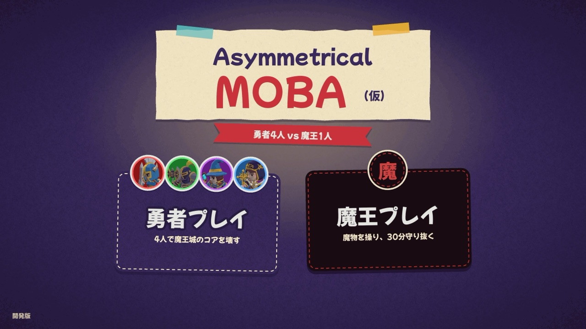

> **開発状況**: 開発中です。今は1人のプレイヤーと BOT で遊べます（足りない勇者は BOT が入り、魔王が BOT のときは今のところ自分では攻めてきません）。オンライン対戦は次のフェーズで作ります。HP やクールタイムなどの数値は、多くが調整前の仮の値です。

## 勝ち負け

| 陣営 | 勝利条件 |
| --- | --- |
| 勇者チーム | 魔王城のコア（HP 3000）を壊す、または魔王本体（HP 500）を倒す |
| 魔王 | はじまりのまちのコア（HP 3000）を壊す |
| 時間切れ（30分） | 魔王の勝ち |

魔王は100秒ごとに自動でレベルが上がり（最大 Lv16）、魔物もそれにつれて強くなります。勇者は早く成長して攻め込む必要があり、魔王は終盤まで耐えるほど有利になります。

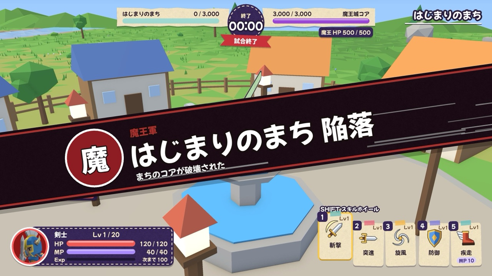

## 試合の流れ

タイトル → 勇者ロビー または 魔王ロビー → マッチロビー（準備1分） → 試合（最大30分） → リザルト

## マップ

500m 四方の島です。左上の「はじまりのまち」から、右下の海に浮かぶ魔王城を目指します。

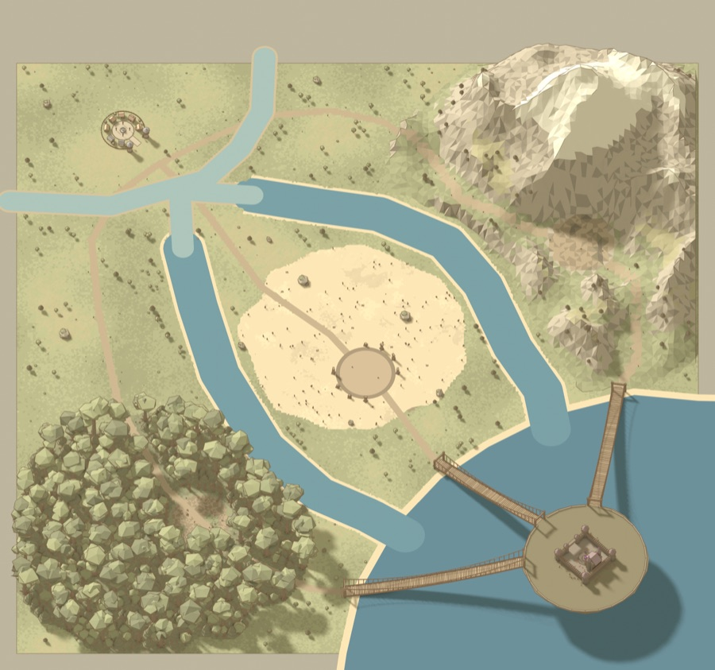

| 場所 | 特徴 |
| --- | --- |
| はじまりのまち | 勇者のスタート地点でリスポーン地点。ここのコアを壊されると負け |
| 森（左下） | 巨大樹が並ぶ森。幹が魔法や視線をさえぎる。中ボスはウェンディゴ |
| 砂漠（中央） | 平らで見通しがよい。魔王の塔が5本立つ（森と山にも2本ずつ）。道を外れた砂地では足が遅くなる。中ボスはスコーピオン |
| 山（右上） | 起伏のある山道。登りでは足が遅くなる。中ボスはドラゴン |
| 魔王城（右下） | 3本の橋でだけ渡れる。橋の前には番人のゴーレムと、中ボスを倒すまで開かない結界がある |

魔王城の手前は深い川で分かれていて、バイオームの間を行き来するには、まちの方まで回り込むことになります。

## 勇者

ジョブを選んで一人称視点で戦います。魔物を倒して経験値を集め、レベル（最大 Lv20）とスキルを上げていきます。ジョブの重複もできます。

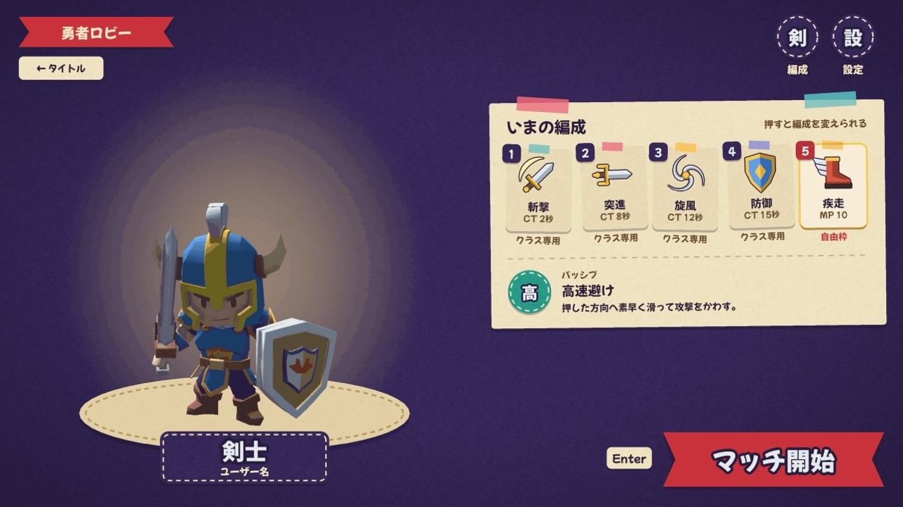

| ジョブ | HP | MP | 戦い方 | スキル |
| --- | --- | --- | --- | --- |
| 剣士 | 120 | 40 | 近接の基本形 | 斬撃 / 突進 / 旋風 / 防御 |
| 魔法使い | 80 | 70 | 遠距離の魔法 | 火球 / 吹雪 / ワープ / 魔力の盾（爆発に入れ替え可） |
| 僧侶 | 100 | 70 | 回復と支援 | 回復 / 全体回復 / 祝福 / 聖撃 |
| 重戦士 | 150 | 25 | 硬くて遅い壁役 | 盾撃 / 挑発 / 踏みつけ / 鉄壁 |

共通スキルは 疾走 / 自己回復 / 探知 / 帰還 の4つです。

スキルは5枠あります。1〜4枠にはジョブのスキルか共通スキル、5枠目にはどのスキルでも入ります。魔法系のスキルは MP を使い、物理系のスキルはクールタイムだけで撃てます。

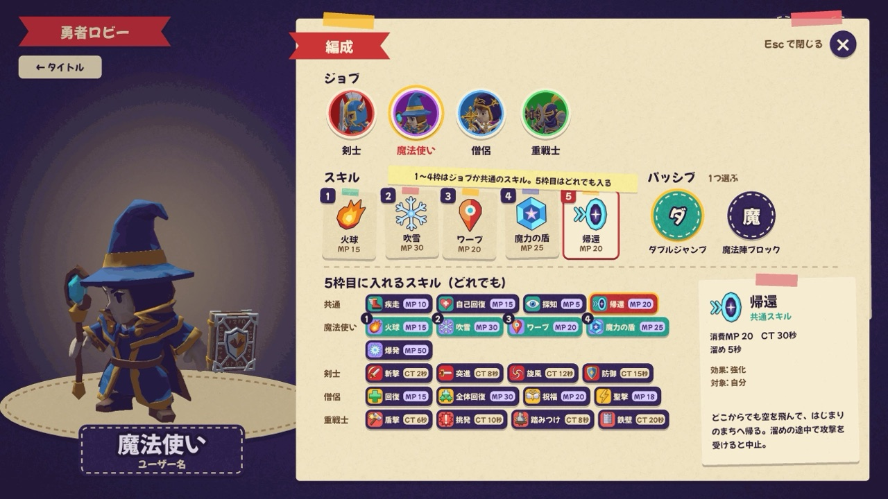

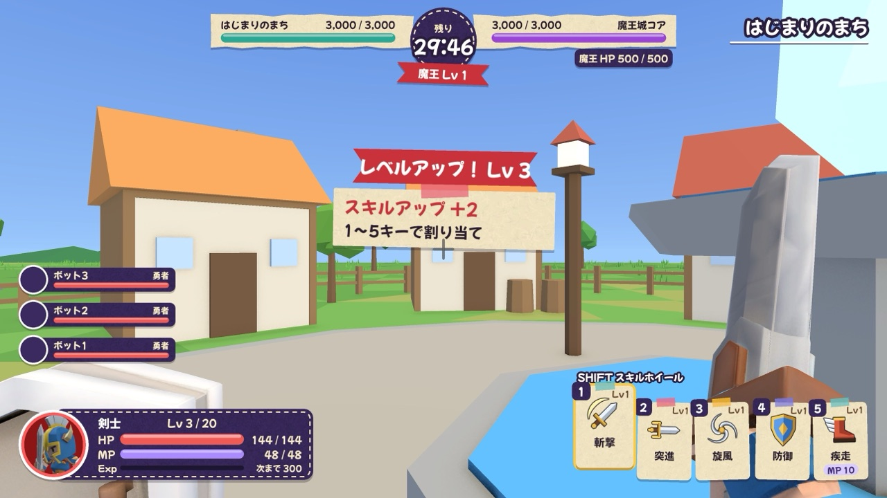

倒されると、はじまりのまちでリスポーンします。前線へ早く戻る手段は、魔法使いの「ワープ」（2か所に門を開いてつなぐ）です。

## 魔王

三人称視点で自分でも戦えますが、城の外にいると MP が減り続け、移動速度と攻撃力も落ちていきます。城の中が一番強い状態です。

### 試合前の配置

魔王ロビーでは地図の上で配置を決めます。

- 山・森・砂漠に、通常魔物（3枠）と中ボスを置く
- 3本の橋に番人（ゴーレム）を置く
- フィールド魔法を6種類から5つ装備する

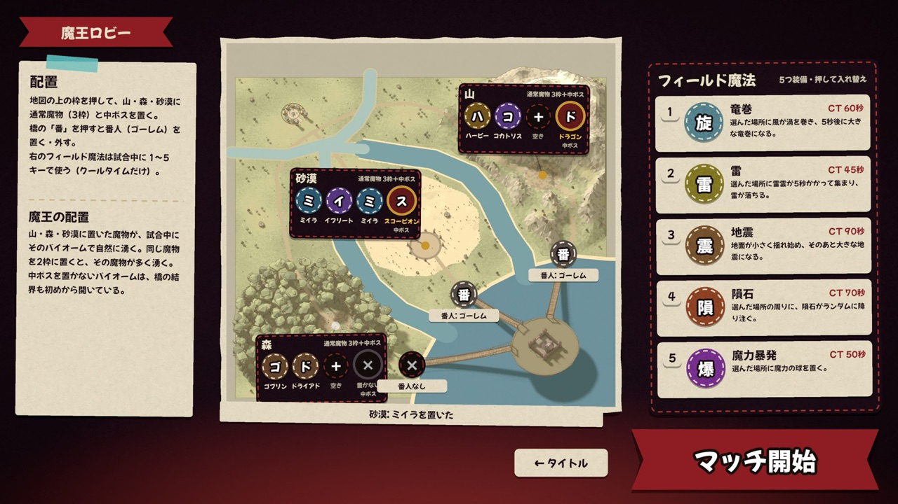

### 俯瞰モード

魔王城のコアに触れて `V` を押すと、マップ全体を見渡せます。塔に魔物を追加でき、MP を使う探知スキルで勇者の位置も分かります。

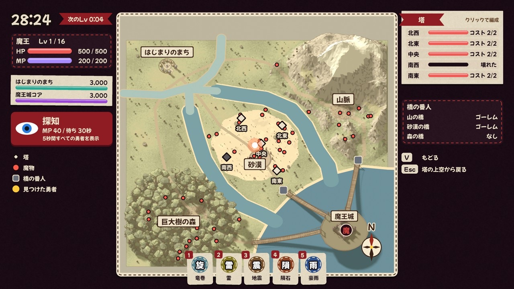

### フィールド魔法

試合中に `1`〜`5` キーで使います。消費するのはクールタイムだけです。TPS では画面の真ん中の地面を、俯瞰では地図の上を狙い、左クリックで発動します。発動前の予兆は勇者にも見えるので、よけることができます。

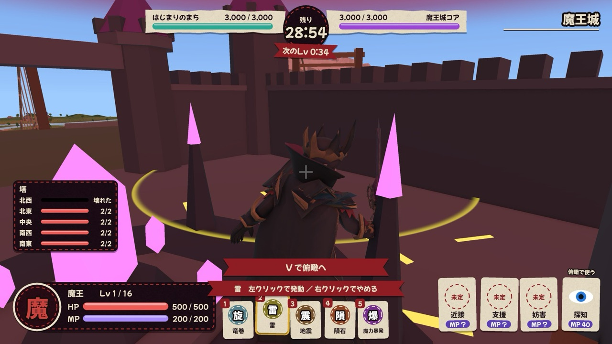

| 魔法 | CT | 効果 |
| --- | --- | --- |
| 竜巻 | 60秒 | 5秒溜めて大きな竜巻に。巻き込んだ勇者を空へ打ち上げ、岩も投げる |
| 雷 | 45秒 | 5秒かけて雷雲が集まり落雷。直撃は大ダメージ、周りにも小〜中ダメージとスロー |
| 地震 | 90秒 | 予震のあと本震。地面にいる全ての勇者と、地上の魔物にダメージ |
| 隕石 | 70秒 | 狙った場所の周りに隕石が降り、落ちた所にクレーターができる |
| 魔力暴発 | 50秒 | 魔力の球を置く。3〜5秒で爆発し、攻撃されるとその場で爆発する |
| 豪雨 | 120秒 | バイオーム全体を大雨に。勇者は遅くなり横風に押される。濡れた地面では雷が強くなる |

<table>
  <tr>
    <td>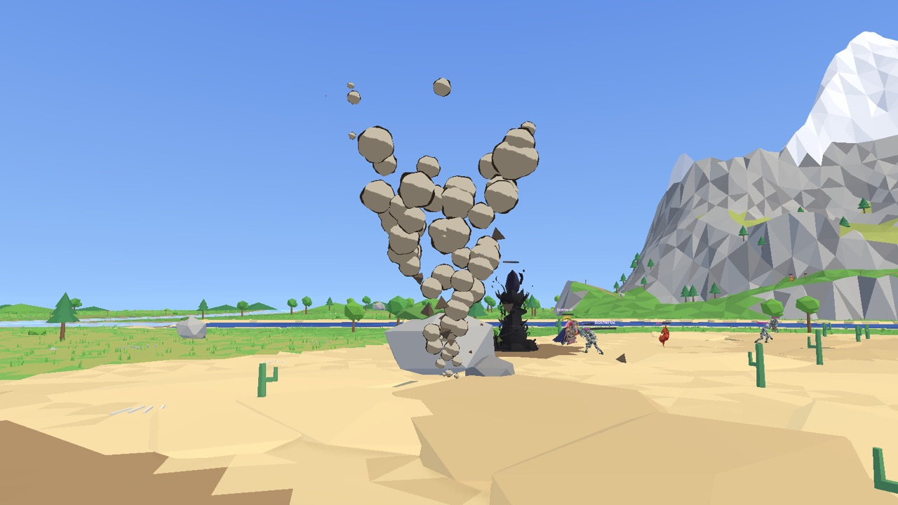</td>
    <td>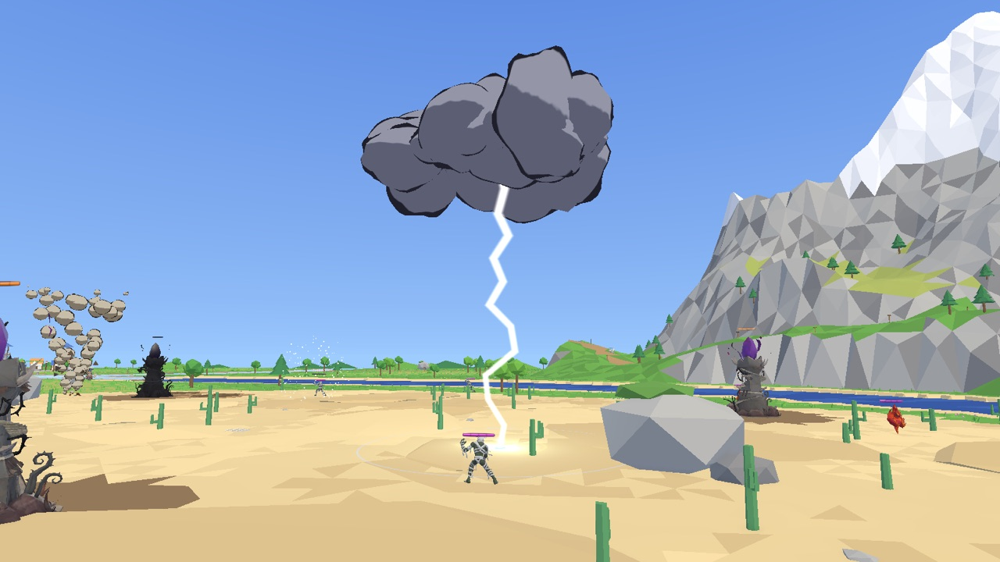</td>
  </tr>
  <tr>
    <td align="center">竜巻</td>
    <td align="center">雷</td>
  </tr>
  <tr>
    <td>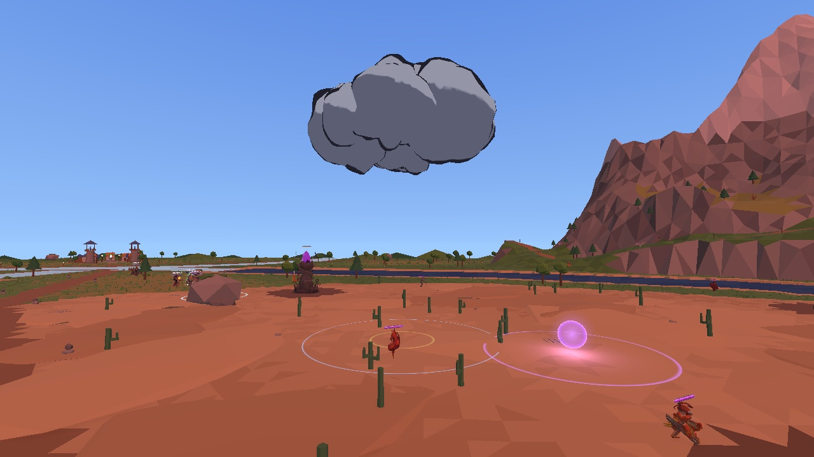</td>
    <td>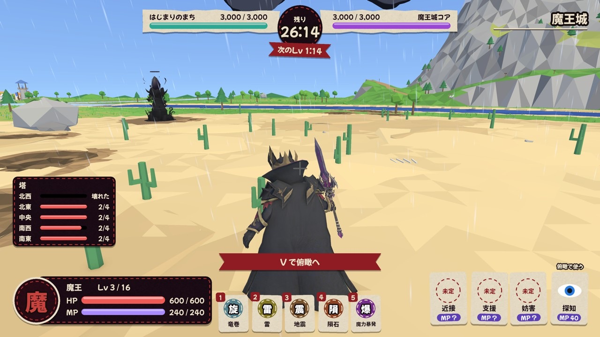</td>
  </tr>
  <tr>
    <td align="center">雷雲と魔力暴発の球</td>
    <td align="center">豪雨</td>
  </tr>
</table>

## 魔物とボス

魔物はバイオームごとに、そこに立つ魔王の塔の周りに自然に湧き、勇者に重ならない距離を保って戦います。塔そのものからも魔物が出ます。塔は一度壊すと戻らず、バイオームの塔をすべて壊すとそこには魔物が湧かなくなります。

| バイオーム | 通常魔物 | 中ボス |
| --- | --- | --- |
| 森 | ゴブリン、ドライアド | ウェンディゴ |
| 山 | ハーピー、コカトリス | ドラゴン |
| 砂漠 | ミイラ、イフリート | スコーピオン |

<table>
  <tr>
    <th>森</th>
    <th>山</th>
    <th>砂漠</th>
  </tr>
  <tr>
    <td>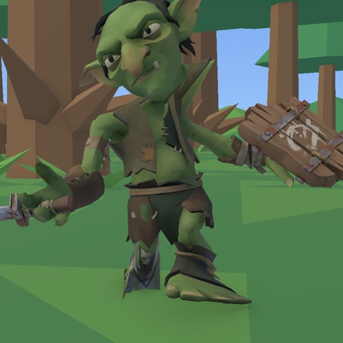</td>
    <td>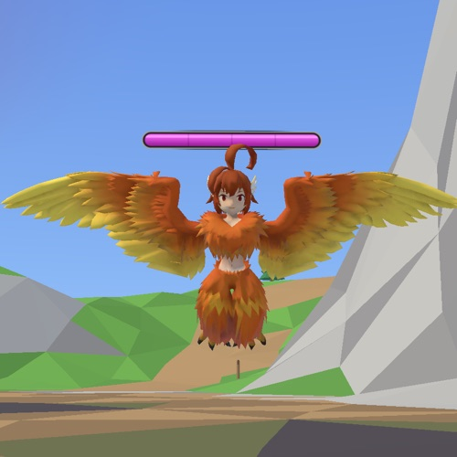</td>
    <td>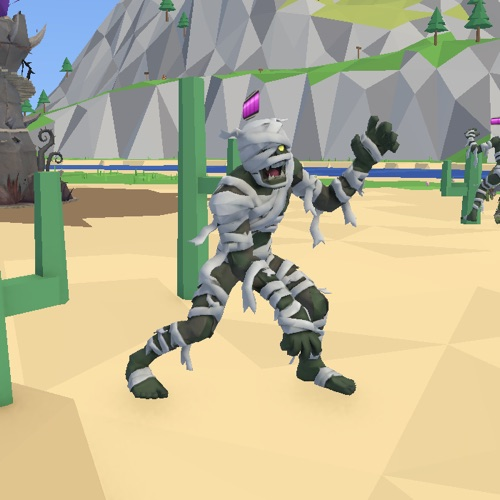</td>
  </tr>
  <tr>
    <td align="center">ゴブリン 短剣と木の盾で斬りかかる</td>
    <td align="center">ハーピー 飛び上がって羽ばたき、羽根を飛ばす</td>
    <td align="center">ミイラ 包帯で引き寄せて殴る</td>
  </tr>
  <tr>
    <td>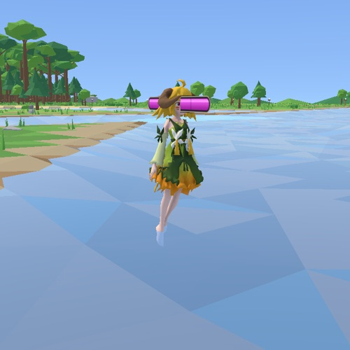</td>
    <td>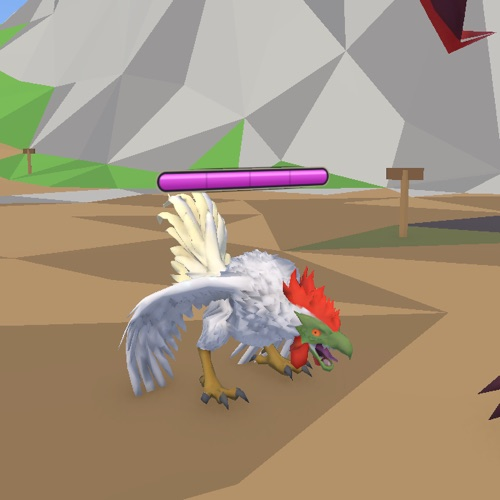</td>
    <td>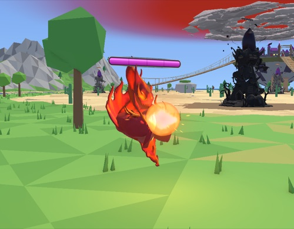</td>
  </tr>
  <tr>
    <td align="center">ドライアド 葉の刃を飛ばす</td>
    <td align="center">コカトリス 舞い上がってダイブする</td>
    <td align="center">イフリート 両手の間に火球を作って撃つ</td>
  </tr>
</table>

<table>
  <tr>
    <td>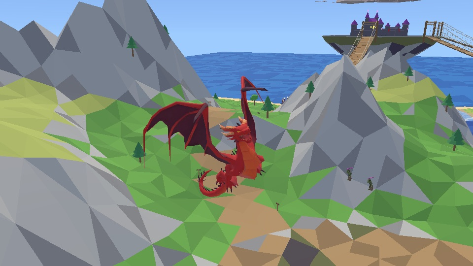</td>
    <td>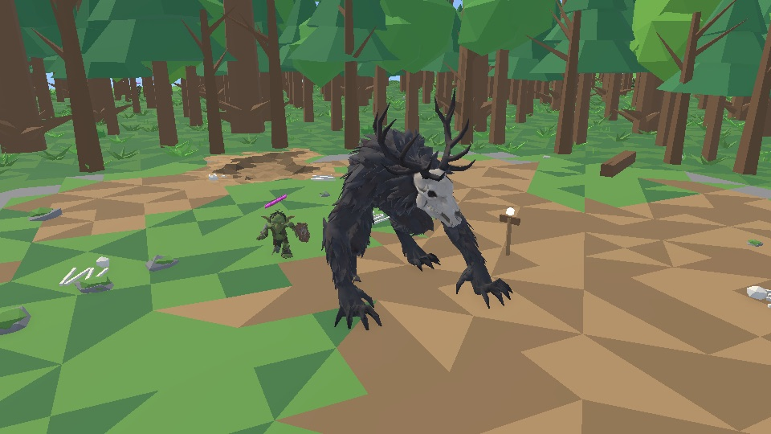</td>
  </tr>
  <tr>
    <td align="center">山の広場のドラゴン</td>
    <td align="center">森の広場のウェンディゴ</td>
  </tr>
</table>

橋の番人のゴーレムは、地面を叩きつけて岩の槍を走らせます。

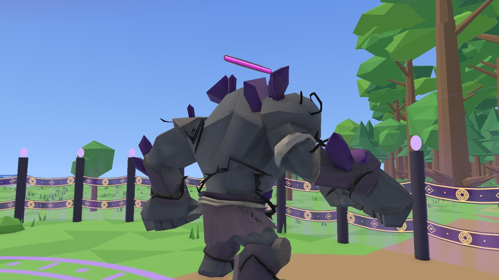

## 操作

| 操作 | 勇者 | 魔王 |
| --- | --- | --- |
| 移動 / 視点 | `WASD` / マウス | `WASD` / マウス |
| 左クリック | 通常攻撃 | フィールド魔法の発動（狙っているとき） |
| 右クリック | スキル発動（`E` でも可） | フィールド魔法の取り消し |
| `1`〜`5` | スキルポイントの割り当て | フィールド魔法を選ぶ |
| 左 `Shift` 長押し | スキルホイール | - |
| `W` を2回押して押し続ける | ダッシュ | - |
| `V` | - | 俯瞰モードの切り替え（コアに触れているとき） |
| `Esc` | メニュー | メニュー |
| `/` または `Tab` | コンソール | コンソール |

`/debug help` と入力すると、開発用のコマンドの一覧が出ます。

## 動かし方

1. Unity Hub で **Unity 6000.4.10f1** をインストールします
2. このフォルダをプロジェクトとして開きます
3. `Assets/_Project/Scenes/Title.unity` を開いて再生します

## フォルダ

| 場所 | 中身 |
| --- | --- |
| `Assets/_Project/Scripts` | ゲームのコード（Hero / DemonKing / Monster / Skill / UI / Bot / Core など） |
| `Assets/_Project/ScriptableObjects`, `Assets/_Project/Resources` | ジョブ・スキル・魔物・フィールド魔法などの数値とモデル |
| `ArtSource` | モデルのリグや地形を作る Blender のデータとスクリプト |
| `docs/game-design.md` | 仕様書（細かい仕様と数値はこちら） |
| `docs/unity-implementation-plan.md` | 実装のフェーズ表 |
